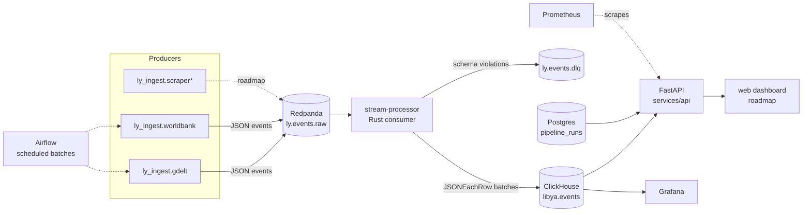

# Architecture

Libya Data Platform is an open, real-time data platform that collects
public data about Libya — news events, economic indicators, and scraped
primary sources — and serves it through a single API and dashboards.

Status: **v0 — local development stack.** See `docs/roadmap.md` for the
deployment path.

## Data flow

`*` planned. The existing `Scrap-app` project's HTTP engine is being
ported into `ly_ingest.common`; `Libya-natural-resources` becomes the
public dashboard in a later milestone.

## Component decisions

| Decision | Choice | Why |
| --- | --- | --- |
| Message bus | **Redpanda** | Kafka-compatible API (the ecosystem skill that matters) in a single binary — no ZooKeeper, sane local dev. |
| Analytics store | **ClickHouse** | Columnar MergeTree for time-series event data; fast aggregations, cheap local footprint, real production usage. |
| Metadata store | **Postgres** | `pipeline_runs` lineage + Airflow metastore; the right tool for small relational data. |
| Stream processor | **Rust** (`rdkafka` + HTTP inserts) | Batched, back-pressured, single-digit-MB consumer; deliberately not another Python service. |
| Producers | **Python** (`requests` + `kafka-python-ng`) | Fast iteration against messy upstream APIs; reuse of hardened scraping patterns. |
| Serving | **FastAPI** | Async read layer over ClickHouse/Postgres with free OpenAPI docs. |
| Orchestration | **Airflow** (`standalone`, `orchestration` profile) | Scheduled batch pulls (World Bank cadence) with retries/backfill — and a real upstream project to contribute to. |
| Observability | **Prometheus + Grafana** | Provisioned datasources and a pipeline-health dashboard out of the box. |

## Event contract

Everything on `ly.events.raw` conforms to
[`contracts/event.schema.json`](../contracts/event.schema.json) — one
envelope regardless of source, keyed by `event_id`. The processor
validates each record; violations land in `ly.events.dlq` with the error
attached so they can be replayed after a fix. See
[`contracts/topics.md`](../contracts/topics.md) and
[`contracts/services.md`](../contracts/services.md).

## Failure model

- **Producer crash**: restart policy `unless-stopped`; sources are polled
  on an interval so a missed pass self-heals. Each pass is logged to
  `pipeline_runs`, so gaps are visible in `/runs`.
- **Schema violation**: record → DLQ, processing continues.
- **ClickHouse down**: processor buffers until `BATCH_FLUSH_MS`/size cap,
  then backs off and retries; offsets are only committed after a
  confirmed insert, so nothing is lost.
- **Dedupe**: `event_id` = `{source}:{stable upstream id}`; ClickHouse
  queries dedupe by `argMax`/ReplacingMergeTree is a roadmap item.

## Trade-offs taken (and why)

- **JSON over Schema Registry/Protobuf**: JSON keeps the contract readable
  in Redpanda Console and lowers the barrier for a portfolio piece; the
  schema lives in `contracts/` and is enforced at the consumer. Moving to
  Redpanda's built-in Schema Registry is a documented roadmap step.
- **One producer image, N containers**: `producer-gdelt` and
  `producer-worldbank` share the `ly_ingest` image with different
  commands — mirrors how a scheduler (Airflow) reuses the same package.
- **HTTP inserts over native protocol**: the `clickhouse` Rust client
  speaks HTTP — one dependency, TLS-ready, fast enough at this scale.
